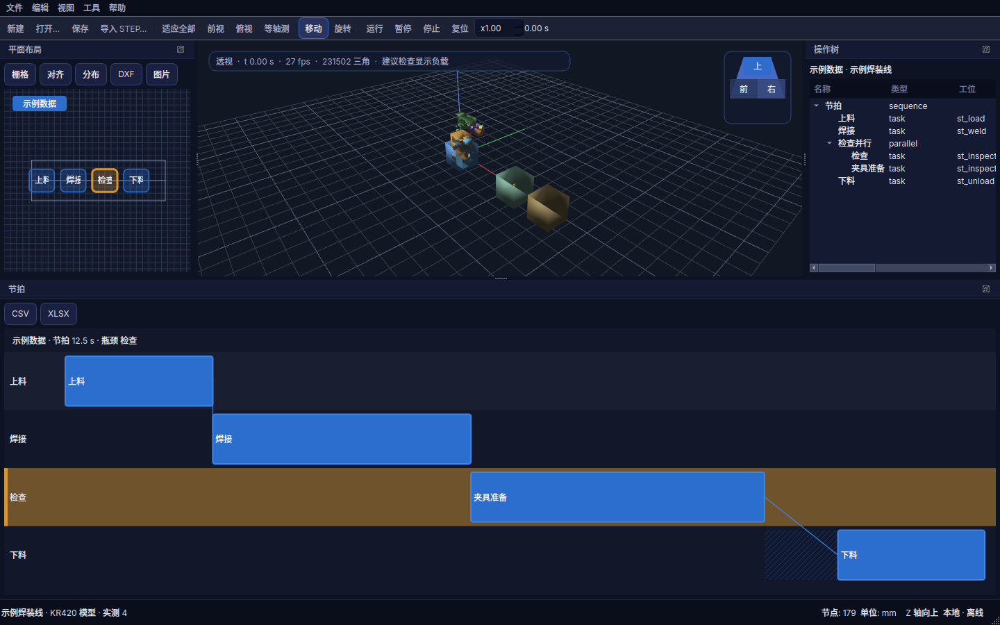
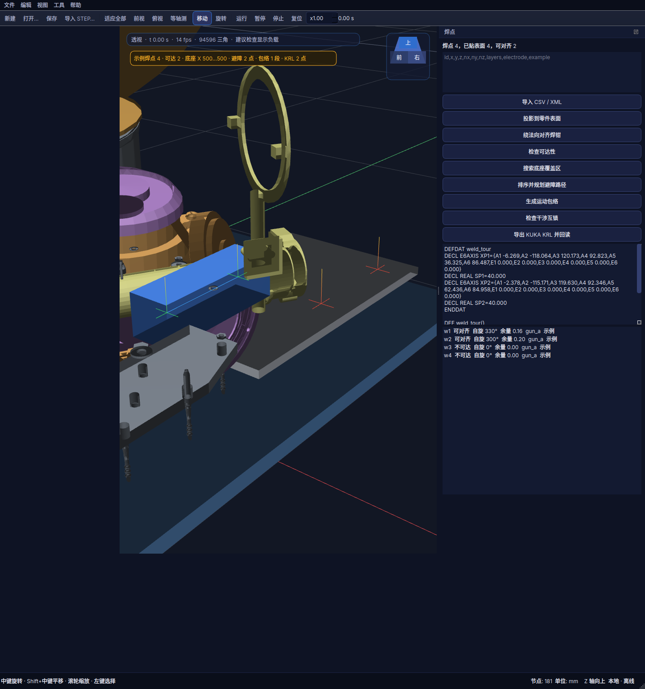
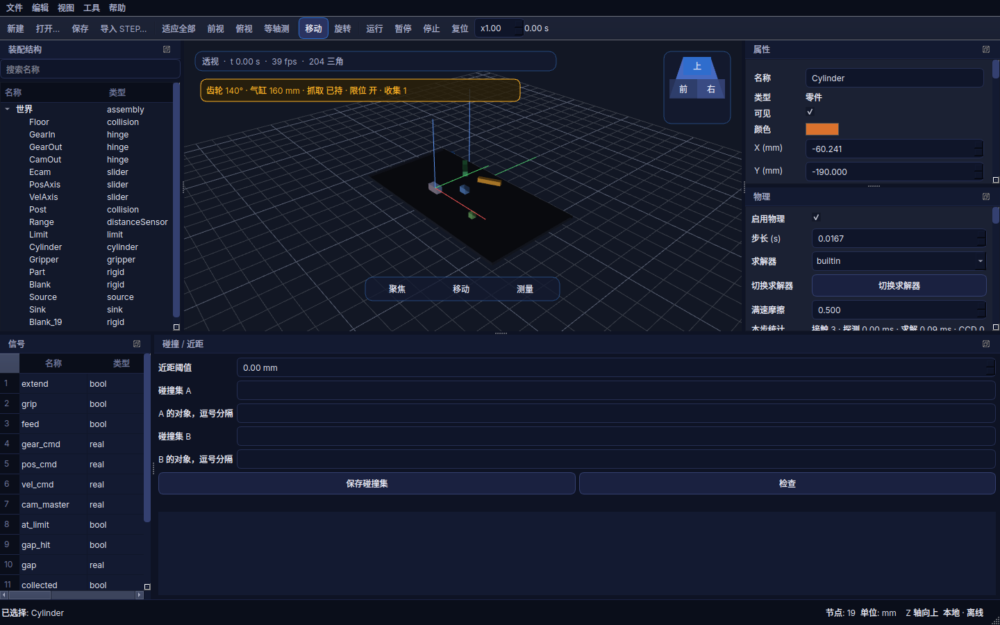
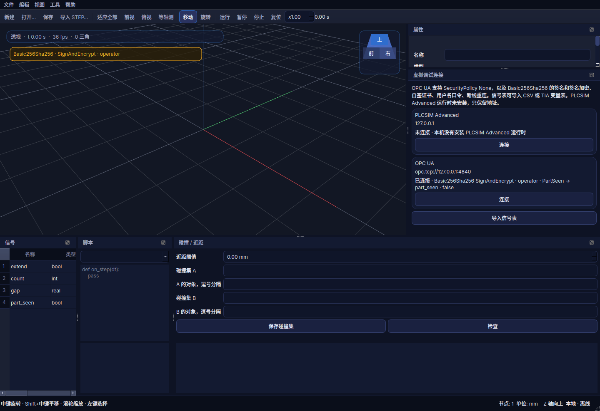
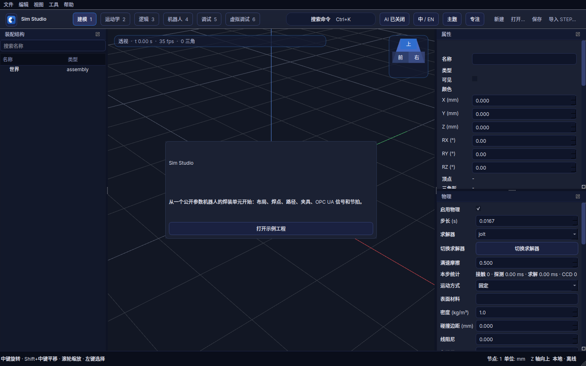
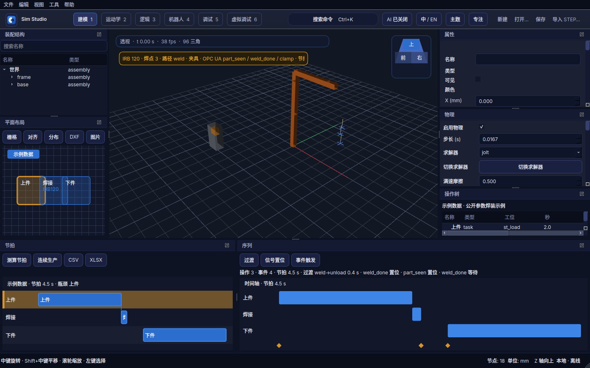

# Sim Studio 用户手册

这份手册按一条焊装线的实际顺序来走：把模型放进场景，排工位和工序，看节拍，再生成可以往返阅读的离线程序。后面两节补上机电装置和 OPC UA。

界面是深色底、品牌蓝（`#2C6ECE`）。顶栏有六个任务模式：建模、运动学、逻辑、机器人、物理、虚拟调试。场景单位是毫米，Z 轴向上。

下面的图都来自本机软件渲染，命令形如：

```bash
simstudio --demo line --lang zh_CN
simstudio --demo line-weld --lang zh_CN
simstudio --demo mcd --lang zh_CN
simstudio --demo plc --lang zh_CN
```

## 1. 导入模型

文件菜单里可以导入 STEP 或 OBJ，也可以打开 `.simproj`。导入在后台线程里进行，进度条可以取消。导入完成后视口会缩放到全部对象，状态栏给出节点数、网格数和三角形数。

STEP 读入使用 Open CASCADE。装配会展开成零件节点。机器人若还没有运动学，可以用连杆建议把相邻零件收成连杆，再套上数据表里的关节限位。示例里的 KR420 代理在没有本地 STEP 时仍能排布；本机若放了 `testdata/local/KR420_R3080_KR280_R3080.stp`，示例线会把该模型接到名为 `kr420` 的资源上。这个 STEP 不进版本库。

也支持这些交换格式，各自有明确边界：

- URDF 和 xacro：关节、连杆和视觉网格会进来，并建成一台机器人资源。`package://包名/路径` 会在文件目录、上一级，以及 `ROS_PACKAGE_PATH`、`SIM_PACKAGE_PATH` 里查找。网格按米读入后再乘 1000 和缩放，变成毫米。关节写了 `effort`、连杆写了质量时，加速度来源是动力学。
- glTF：网格、节点和形态目标会进来。权重为 0 时形状不变。
- DXF：直线、圆弧、圆、多段线、均匀三次样条、三维面和椭圆会进来。填充按图案线裁到边界里。尺寸有尺寸线、箭头和笔画文字。INSERT 会递归展开。
- IGES：走已经链接的 Open CASCADE。读失败就返回错误，不造网格。
- JT：没有解码器。
- eBOP / PPR XML：读写操作、资源、零件、焊点、路径和位置。认不出的元素按原文字写回。这不是某家软件的完整模式。

## 2. 产线布局

建模模式下，左侧是布局，右侧是属性。示例线有上料、焊接、检查、下料几个工位。工位在平面上占一块区域，资源名（例如 `kr420`）挂在工位上。


选中工位后可以改名称、位置和绑定的资源。场景树列出零件；零件很多时树是按可见行取数的，不会把十万个名字一次画出来。

## 3. 工序

工序树按工位列出操作。每条操作有计划时间和实测时间。计划时间是排程用的输入。实测时间来自仿真：逻辑块的等待、机器人轨迹的节拍、传感器从假变真的时间、输送一段距离的时间。检查工序在示例里由传感器置位，不再只靠手工填的秒数。


逻辑块只通过信号表和别的块交换数据。动作有点动、姿态移动、置位、复位、写实数、等待和等待信号。写实数用于把目标位置或目标速度交给机电装置。

## 4. 节拍

甘特图把操作画成色条。关键路径用品牌蓝标出。并行工位取较长的那一条，等待时间加在所属操作上。



示例线在加入双机互锁之前，上料、焊接、检查、夹具准备和下料叠出来的完工时间是 12.5 秒。夹具准备是 4 秒，检查只有 0.4 秒，所以检查工位旁边的准备时间会把后段撑开。互锁一旦成立，焊接工位再加一段释放保持，完工时间跟着变长。保持加在操作的等待上，第二次计算不会重复加。

甘特图上拖动色条不会自动建立前后约束。约束仍在工序数据里。

## 5. 焊点、包络和离线程序

机器人模式下打开焊点面板。焊点可以投影到零件表面，焊钳 TCP 的 +Z 对着钢板法向的反方向。每个焊点会做逆解、奇异检查、关节裕度和一次接近碰撞检查。奇异指腕部第 5 轴绝对值小于 2 度。裕度是离较近限位的距离，再除以半个行程。

不可达的焊点会给出一条修正建议：已可达、换焊钳姿态、沿法向挪 TCP、移底座，或加外部轴。建议是一次正逆解试探，不是重新搜索整片底座区域。

两台机器人可以共享一个球形干涉区。第二台在示例里是 KR280 代理：同一套解析模型再加一根 350 毫米的外部轨，视口里是橙色盒子。两台 TCP 同时落在区内时，信号 `interlock_焊点区名` 置真，并把该区的释放时间加到焊接操作的等待上。

运动包络按连杆来扫。有连杆网格时，沿关节样本（步长不超过 20 度）取该连杆网格包围盒的八个角，再对相邻样本做凸包。没有连杆网格、而且是球腕模型时，用四段解析臂杆代替。这不是 STEP 三角面沿螺旋运动的连续扫掠。

离线程序目前有三段：

- KUKA：`.src` / `.dat`。含 `PTP`、`LIN`、`SPL`、`SLIN`、`SPLINE` / `ENDSPLINE`、`$TOOL`、`$BASE`、`INTERRUPT` 和 `$OUT` 一类 IO 行。`$TOOL` / `$BASE` 是 XYZABC。导入会把这些再读回路径。没有完整的 BAS 和工具标定数据，中断文本会保存并再次写出，不会在仿真里执行中断程序。
- ABB：RAPID 子集。`confdata` 置零，未使用的外部轴写成 `9E9`。
- FANUC：ASCII LS。没有二进制 TP。

示例 KR420 没有外部轴时，导出的 E1 到 E6 是 0。单元测试里非零外部轴可以改 `.dat` 再导回来。




避障轨迹在关节空间里做双向 RRT，再做短路平滑。直线段若已经无碰撞，结果就是起点和终点。演示里的障碍是关节空间里的一块平板；连接失败时会退回直线段。

## 6. 机电

物理模式使用内置求解器时，这些装置会步进，并由逻辑块或 OPC UA 写入的信号驱动：

- 齿轮：从动关节位置等于主动关节位置乘以传动比。
- 凸轮：主动位置经过分段线性表，得到从动位置。
- 电子凸轮：主动量是一个实数信号，表和凸轮相同。
- 位置控制器：实数设定值写成关节目标。
- 速度控制器：实数设定值乘以增益，作为关节速度。
- 距离传感器：射线命中时布尔信号为真，距离信号写下命中距离。
- 限位开关：被监视关节的位置达到行程后置位。
- 气缸：布尔信号决定伸出或缩回。节流是最大速度的比例。缓冲时间把末端速度按指数收下来，单步不会一下贴到终点。
- 抓手：抓取信号为真时吸住半径内最近的自由刚体，信号撤销后释放。被抓住的物体在内置求解器里不再受重力下拉。
- 发生器：使能信号为真才按间隔克隆原型。
- 收集器：重叠的自由刚体会被删掉，布尔信号置真，计数信号加一。

Jolt 后端不跑齿轮、凸轮、气缸和抓手。这些装置只在内置求解器里积分。



示例里齿轮约 140 度，气缸约 160 毫米，抓手持有零件，限位打开，收集计数为 1。属性里选中的是气缸。

## 7. OPC UA 与信号表

虚拟调试模式里有两张连接卡。PLCSIM Advanced 只保留地址，本机没有该运行时，不会去连它。

OPC UA 客户端和回环服务器都是按二进制分块自己写的。策略有两种：

- `SecurityPolicy#None`：不签名、不加密。
- `Basic256Sha256`：Sign，或 SignAndEncrypt。非对称用 RSA-SHA256 和 RSA-OAEP，对称用 AES-256-CBC 和 HMAC-SHA256，密钥由 P-SHA256 从双方随机数推出。证书是 RSA-2048 自签，可以存成 PEM 再读回来。加密库是 OpenSSL 3（Apache-2.0），见 `docs/DEPENDENCIES.md`。

用户名和口令放在激活会话的身份令牌里，口令用服务器证书加密，并带上创建会话时的服务器随机数。口令不对时激活失败。`reconnect` 会重新走 Hello、打开安全通道、创建会话和激活会话。

信号表可以一次导入。CSV 为 `name,type,value`。TIA 变量表文本导出是分号分隔、带引号的列，名称在第一列，数据类型在第三列。布尔、整数和实数会写进场景信号，逻辑块和机电装置接着用这些信号。



这套协议和本仓库的回环服务器对测过。没有和 open62541 互通，也没有连上 PLCSIM。

## 8. 序列、加速度和示例工程

序列停靠栏在工序旁边放时间轴。过渡把后一道工序推迟到前一道结束，再加一段延迟。信号事件可以在工序开始或结束置位，另一道工序可以等这个信号。甘特图和平面图用同一份排程。

运动学页的加速度旋钮会标来源。有扭矩和惯量时按扭矩除以惯量估算，负载再按平行轴定理折低，来源写成「动力学」。直接改旋钮则来源是「用户」。两者都没有时，界面写明节拍只受速度限制，规划不再使用 180°/s² 这个占位。笛卡尔和圆弧轨迹会把加速度压进关节限制。

空工程的视口中央有欢迎卡。「打开示例工程」装入 IRB 120 焊装单元：上件、焊接、下件，三个焊点，路径 `weld`，夹具，信号 `part_seen`、`weld_done`、`clamp`，以及序列节拍。这台机器人用公开样本里的限位和连杆原点，不用 KR 420 的 STEP。夹具质量 8 kg、推力 40 N，加速度由这两项估成 5000 mm/s²。臂关节没有公开扭矩，来源仍是速度限制。

机器人目录还有 KR6 R900、LR Mate 200iD 和 GP8。限位、速度和连杆原点的出处在 `docs/ROBOTS.md`。几何是方盒。

逻辑图画布可以拖节点、从输出拖到输入、双击改步骤。运动学页可以在视口里点中连杆，用滑块拖关节，并把姿态存进姿态库。示波器按仿真时间记录勾选的信号和关节，画速度和加速度。






## 9. 还没做到的部分

- JT 不能解码。DXF 不是每一种图元。eBOP XML 不是完整的厂商模式，只覆盖操作、资源、零件、焊点、路径和位置；其余元素原样保留。
- 十万零件压测是在 llvmpipe、MSAA 4、1440×900 下测的：提交 10 万个实例、2560 万三角形时整帧约 2938 毫秒；近处视锥剔除后约 81 毫秒。软件遮挡对平铺的 10 万个零件是 0，贴墙擦过时遮挡 17877 个。GPU 剔除是一次 430 路计算调度，不是每一帧都走的路径。
- Jolt 没有沿曲面骑行，网格碰撞体是凸包。网格对网格走双侧 BVH，连续碰撞和多点接触在内置求解器里。没有把 Jolt 的 CCD 重写一遍。
- 焊点自旋搜索不会对每一个转角都做碰撞，只在选中的姿态上做一次接近检查。
- KUKA 样条只有 SPL / SLIN，没有完整 BAS。FANUC 只有 ASCII LS。
- 目录里的四台机器人没有公开的关节扭矩和连杆惯量。KR420 网格示范路径的页脚会带上规划器返回的 `unreachable`。
- 不生成 Windows 安装包。
