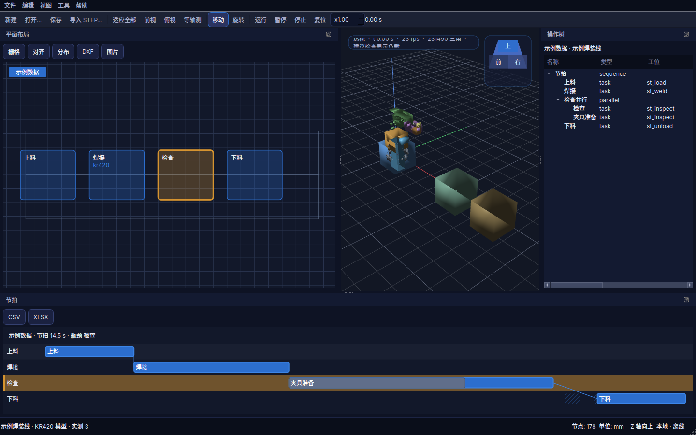
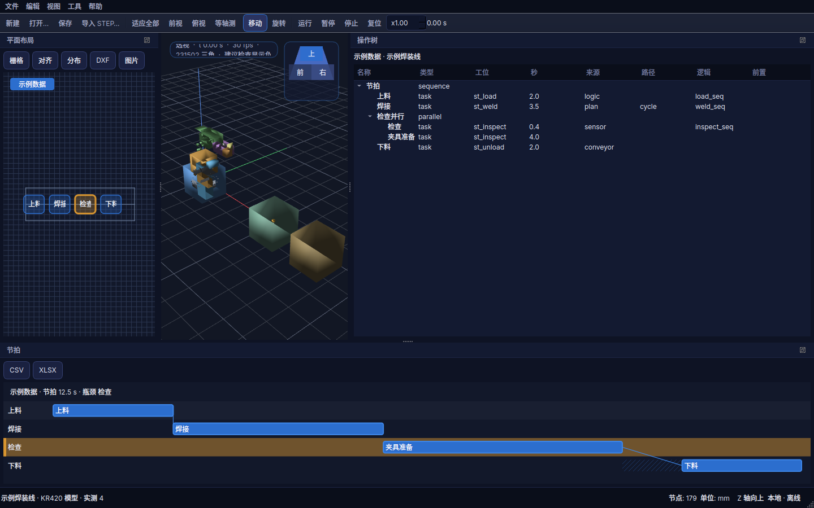
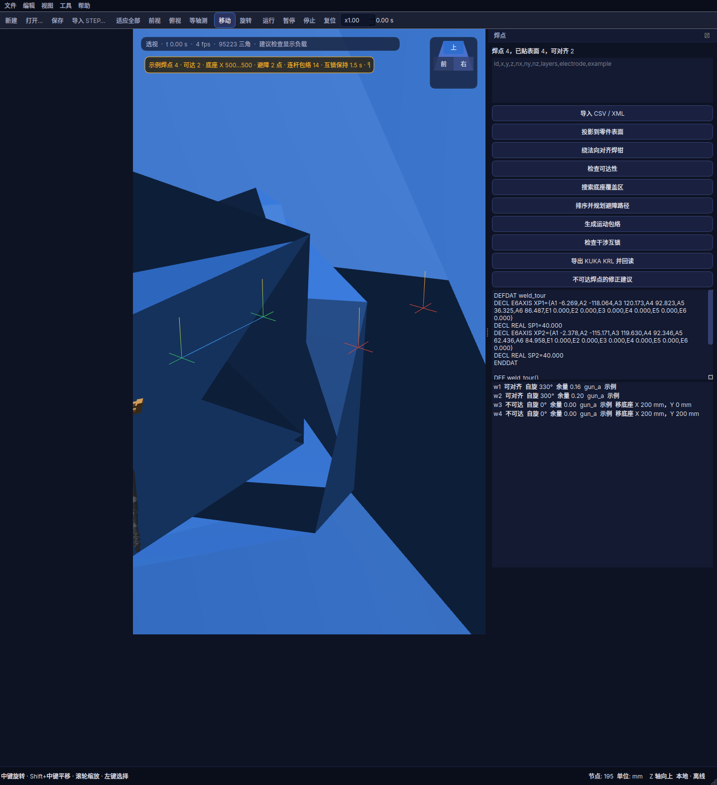
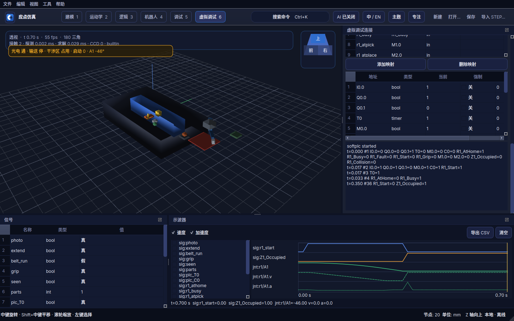
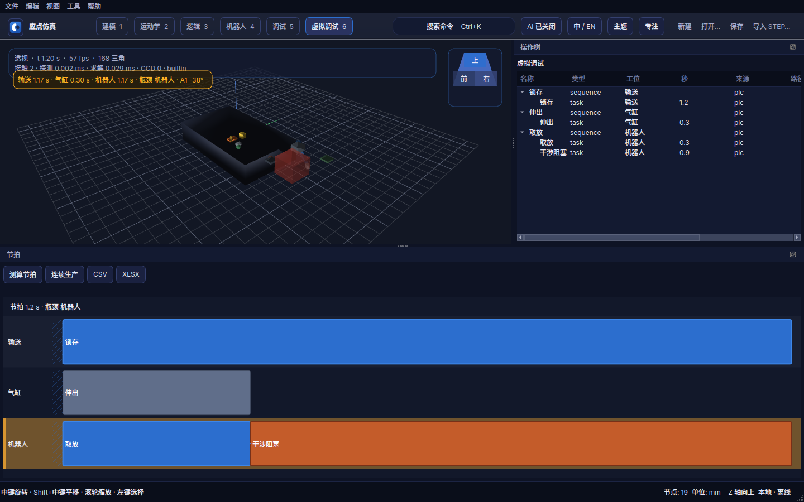
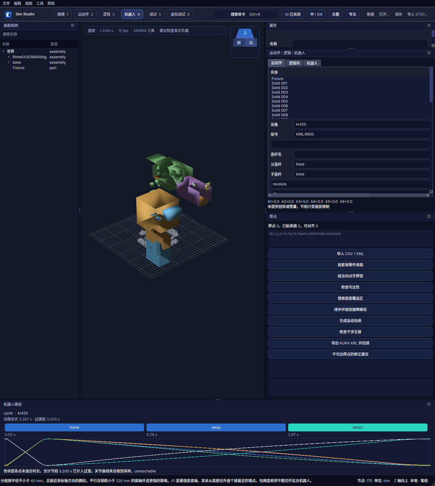

# 应点仿真 用户手册

应点仿真属于应点 Ondot 品牌系列，英文名 Ondot Sim。工程文件仍是 `.simproj`，脚本模块名仍是 `simstudio`。蓝色工业标志沿用现有版本。

这份手册按一条焊装线的实际顺序来走：把模型放进场景，排工位和工序，看节拍，再生成可以往返阅读的离线程序。后面两节补上机电装置和 OPC UA。

界面是深色底、品牌蓝（`#2C6ECE`）。顶栏有六个任务模式：建模、运动学、逻辑、机器人、物理、虚拟调试。场景单位是毫米，Z 轴向上。

下面的图都来自本机软件渲染，命令形如：

```bash
simstudio --demo line --lang zh_CN
simstudio --demo line-weld --lang zh_CN
simstudio --demo mcd --lang zh_CN
simstudio --demo plc --lang zh_CN
simstudio --demo commission --play --sim-seconds 1.5 --lang zh_CN
```

## 1. 导入模型

文件菜单里可以导入 STEP 或 OBJ，也可以打开 `.simproj`。导入在后台线程里进行，进度条可以取消。导入完成后视口会缩放到全部对象，状态栏给出节点数、网格数和三角形数。

STEP 读入使用 Open CASCADE。装配会展开成零件节点。导入后状态栏给出文件里的产品数、装配出现数、实体数，以及场景节点、网格、三角形和无网格零件；每一条警告都能对上文件里的一项。支持的模式和与 PDPS 的差距写在 `docs/STEP.md`。NX 或 MCD 的 `.prt` 不读，对应关系写在 `docs/MCD_COMPAT.md`。`--demo mcd-compat` 用光电、气缸和吸盘接软 PLC。机器人若还没有运动学，可以用连杆建议把相邻零件收成连杆，再套上数据表里的关节限位。示例里的 KR420 代理在没有本地 STEP 时仍能排布；本机若放了 `testdata/local/KR420_R3080_KR280_R3080.stp`，示例线会把该模型接到名为 `kr420` 的资源上。这个 STEP 不进版本库。

也支持这些交换格式，各自有明确边界：

- URDF 和 xacro：关节、连杆和视觉网格会进来，并建成一台机器人资源。`package://包名/路径` 会在文件目录、上一级，以及 `ROS_PACKAGE_PATH`、`SIM_PACKAGE_PATH` 里查找。网格按米读入后再乘 1000 和缩放，变成毫米。关节写了 `effort`、连杆写了质量时，加速度来源是动力学。
- glTF：网格、节点和形态目标会进来。权重为 0 时形状不变。
- DXF：直线、圆弧、圆、多段线、均匀三次样条、三维面和椭圆会进来。填充按图案线裁到边界里。尺寸有尺寸线、箭头和笔画文字。INSERT 会递归展开。
- IGES：走已经链接的 Open CASCADE。读失败就返回错误，不造网格。
- JT：文件头、目录、压缩段、装配、JT 9 拓扑网格，以及 JT 10.0/10.5 带本地头的拓扑三角带会进来。度数超过 64 的面掩码会生成三角形。JT 9.1 的 Range LOD 挂在装配树上，场景留三角形最多的那一级。Parasolid XT 不生成形状。`.jt` 放在 `.cojt` 目录里时，同目录的运动学会挂到连杆上。本机目录的浏览和导入见第 8 章。
- COJT：Process Simulate 组件目录。读运动图、运动参数、KUKA 机器数据和 `.info` 限位，生成连杆和关节。没有轴速度或 DH 的组件不会填上别的机器人的数。
- USDA：自写的文本格式。层级、变换、网格、UsdPreviewSurface 材质、刚体、碰撞、关节、质量和机器人路径的时间采样会往返。坐标是毫米。二进制 USD 不读。
- eBOP / PPR XML：读写操作、资源、零件、焊点、路径和位置。认不出的元素按原文字写回。这不是某家软件的完整模式。

## 2. 产线布局

建模模式下，左侧是布局，右侧是属性。示例线有上料、焊接、检查、下料几个工位。工位在平面上占一块区域，资源名（例如 `kr420`）挂在工位上。



选中工位后可以改名称、位置和绑定的资源。场景树列出零件；零件很多时树是按可见行取数的，不会把十万个名字一次画出来。

## 3. 工序

工序树按工位列出操作。每条操作有计划时间和实测时间。计划时间是排程用的输入。实测时间来自仿真：逻辑块的等待、机器人轨迹的节拍、传感器从假变真的时间、输送一段距离的时间。检查工序在示例里由传感器置位，不再只靠手工填的秒数。



逻辑块只通过信号表和别的块交换数据。动作有点动、姿态移动、置位、复位、写实数、等待和等待信号。写实数用于把目标位置或目标速度交给机电装置。

## 4. 节拍

甘特图把操作画成色条。关键路径用品牌蓝标出。并行工位取较长的那一条，等待时间加在所属操作上。


示例线在加入双机互锁之前，上料、焊接、检查、夹具准备和下料叠出来的完工时间是 12.5 秒。夹具准备是 4 秒，检查只有 0.4 秒，所以检查工位旁边的准备时间会把后段撑开。互锁一旦成立，焊接工位再加一段释放保持，完工时间跟着变长。保持加在操作的等待上，第二次计算不会重复加。

甘特图上拖动色条不会自动建立前后约束。约束仍在工序数据里。

## 5. 焊点、包络和离线程序

机器人模式下打开焊点面板。焊点可以投影到零件表面，焊钳 TCP 的 +Z 对着钢板法向的反方向。每个焊点会做逆解、奇异检查、关节裕度和一次接近碰撞检查。奇异指腕部第 5 轴绝对值小于 2 度。裕度是离较近限位的距离，再除以半个行程。

不可达的焊点会给出一条修正建议：已可达、换焊钳姿态、沿法向挪 TCP、移底座，或加外部轴。建议是一次正逆解试探，不是重新搜索整片底座区域。

两台机器人可以共享一个球形干涉区。第二台在示例里是 KR280 代理：同一套解析模型再加一根 350 毫米的外部轨，视口里是橙色盒子。两台 TCP 同时落在区内时，信号 `interlock_焊点区名` 置真，并把该区的释放时间加到焊接操作的等待上。

运动包络按连杆来扫。有连杆网格时，沿关节样本（步长不超过 20 度）取该连杆网格包围盒的八个角，再对相邻样本做凸包。没有连杆网格、而且是球腕模型时，用四段解析臂杆代替。这不是 STEP 三角面沿螺旋运动的连续扫掠。

离线程序目前有三段：

- KUKA：`.src` / `.dat`。含 `PTP`、`LIN`、`SPL`、`SLIN`、`SPLINE` / `ENDSPLINE`、`$TOOL`、`$BASE`、`INTERRUPT` 和 `$OUT` 一类 IO 行。`$TOOL` / `$BASE` 是 XYZABC。导入会把这些再读回路径。没有完整的 BAS 和工具标定数据，中断文本会保存并再次写出，不会在仿真里执行中断程序。
- ABB：RAPID 子集。`confdata` 置零，未使用的外部轴写成 `9E9`。
- FANUC：ASCII LS。没有二进制 TP。

示例 KR420 没有外部轴时，导出的 E1 到 E6 是 0。单元测试里非零外部轴可以改 `.dat` 再导回来。




避障轨迹在关节空间里做双向 RRT，再做短路平滑。直线段若已经无碰撞，结果就是起点和终点。演示里的障碍是关节空间里的一块平板；连接失败时会退回直线段。

## 6. 机电

物理模式使用内置求解器时，这些装置会步进，并由逻辑块或 OPC UA 写入的信号驱动：

- 齿轮：从动关节位置等于主动关节位置乘以传动比。
- 凸轮：主动位置经过分段线性表，得到从动位置。
- 电子凸轮：主动量是一个实数信号，表和凸轮相同。
- 位置控制器：实数设定值写成关节目标。
- 速度控制器：实数设定值乘以增益，作为关节速度。
- 距离传感器：射线命中时布尔信号为真，距离信号写下命中距离。
- 限位开关：被监视关节的位置达到行程后置位。
- 气缸：布尔信号决定伸出或缩回。节流是最大速度的比例。缓冲时间把末端速度按指数收下来，单步不会一下贴到终点。
- 抓手：抓取信号为真时吸住半径内最近的自由刚体。停在输送面上的刚体也可以吸，吸上之后离开带面，跟着吸盘走。信号撤销后释放。被抓住的物体在内置求解器里不再受重力下拉。
- 发生器：使能信号为真才按间隔克隆原型。
- 收集器：重叠的自由刚体会被删掉，布尔信号置真，计数信号加一。

Jolt 后端不跑齿轮、凸轮、气缸和抓手。这些装置只在内置求解器里积分。


示例里齿轮约 140 度，气缸约 160 毫米，抓手持有零件，限位打开，收集计数为 1。属性里选中的是气缸。

## 7. OPC UA 与信号表

虚拟调试模式里有两张连接卡。PLCSIM Advanced 的按钮会走 `IPlcBackend` 适配器，本机没有该运行时，启动失败，不会去连它。软 PLC 的梯形图、映射、强制和机器人循环写在第 9 章。信号表和 OPC UA 仍是同一套地址。

OPC UA 客户端和回环服务器都是按二进制分块自己写的。策略有两种：

- `SecurityPolicy#None`：不签名、不加密。
- `Basic256Sha256`：Sign，或 SignAndEncrypt。非对称用 RSA-SHA256 和 RSA-OAEP，对称用 AES-256-CBC 和 HMAC-SHA256，密钥由 P-SHA256 从双方随机数推出。证书是 RSA-2048 自签，可以存成 PEM 再读回来。加密库是 OpenSSL 3（Apache-2.0），见 `docs/DEPENDENCIES.md`。

用户名和口令放在激活会话的身份令牌里，口令用服务器证书加密，并带上创建会话时的服务器随机数。口令不对时激活失败。`reconnect` 会重新走 Hello、打开安全通道、创建会话和激活会话。

信号表可以一次导入。CSV 为 `name,type,value`。TIA 变量表文本导出是分号分隔、带引号的列，名称在第一列，数据类型在第三列。布尔、整数和实数会写进场景信号，逻辑块和机电装置接着用这些信号。


这套协议和本仓库的回环服务器对测过。没有和 open62541 互通，也没有连上 PLCSIM。

## 8. 机器人库

文件菜单「机器人库」打开本机目录，列出 Process Simulate 组件。认的是目录名以 `.cojt` 结尾的文件夹，以及 `.cojt.zip`。压缩包里面若再套一层 `.cojt.zip`，也会列出来。列表可以按品牌和型号过滤。品牌优先取组件上一级目录名；对不上时再看型号前缀，例如 `kr` 归 KUKA，`irb` 归 ABB。预览图用组件里的 `preview.bmp`；没有这张图时格子是空的。

库的根目录记在这台机器的设置里，键是 `library/cojtRoot`，不写进 `.simproj`。换一台电脑要重新选目录。选中一行再导入，会把该组件读进当前工程的机器人资源：运动图、机器数据、关节限位，以及同目录的 JT 网格挂到连杆上。没有轴速度或 DH 的组件不会拿别的机器人的数来填。导入不复制私有模型进仓库。

导入一台手臂后，软 PLC 会追加一组还没接线的布尔标签，见第 9 章。纯外部轴（名字以 `irbt` 开头，或关节都标成地轨、变位机）只追加 `En_InPos`，不占用 `Rn_` 序号。

## 9. 软 PLC 与虚拟调试

虚拟调试模式打开软 PLC 停靠栏：启用、扫描周期、后端、梯形图文字、映射表、强制表和调试日志。默认后端是内置软 PLC，按仿真时钟扫描，一次物理步最多补 8 个扫描。周期取工程里的 `scanSeconds`，小于 0.1 ms 时按 0.1 ms。扫描在逻辑块之前，所以这一步才变成真的光电，要到下一步才进梯形图。PLCSIM Advanced 只有适配器，启动会失败，不打开套接字。

地址是名字，例如 `I0.0`、`Q0.0`、`M0.0`、`T0`、`C0`，也可以是 `R1_Start` 这种标签。类型有布尔、整数、实数、定时器和计数器。

梯形图一条支路里的触点是与。多条支路是或，写在梯级的 `parallel` 里。支路里的一个触点还可以再或上同级触点，写在该触点的 `or` 数组里，只嵌一层，再往下嵌会拒绝。触点默认是常开电平；常闭把 `normallyOpen` 写成假。`edge` 为 `rising` 或 `falling` 时看上一拍扫描结束的电平，沿触点不再看常开常闭。第一拍把上一拍当成假。

线圈动作：

- `out`：线圈跟着梯级功率走。
- `set` / `reset`：功率为真时置位或复位，功率掉了不改。
- `ton`：接通延时。输入为假时已计时间清零，完成位落下。达到预置后完成。
- `tof`：断开延时。输入为真时完成并清零已计时间；输入掉下去之后继续计时，达到预置才落下。没见过真输入的定时器保持断开。
- `ctu`：加计数。梯级功率的上升沿加一，计数值达到预置后完成。
- `ctd`：减计数。上升沿减一，可以减到负数，小于等于 0 时完成，不会自动装入预置。
- `ctr`：梯级为真时把计数清零。
- `move`：功率为真时把字面量写入整数、实数或布尔线圈。

映射表把设备信号或 OPC UA 十进制节点号接到一个地址。方向 `in` 是设备进 PLC，`out` 是 PLC 写出到设备。设备名为空就是还没接线，扫描不会去改那个信号。强制勾上之后，这一拍不再采该地址的输入，线圈也不再改它，映射出去的是强制值。停止仿真会清定时器和计数器的过程值，不清程序和强制。

导入机器人资源后自动追加未接线草稿：`Rn_AtHome`、`Rn_Busy`、`Rn_Fault` 为输入，`Rn_Start`、`Rn_Grip` 为输出。外部轴追加 `En_InPos` 输入。序号从已有的 `Rn_` 往后排。这些草稿不强制。

`--demo commission` 把这张表接到一条光电、输送、气缸、吸盘，以及一台两轴机器人 `r1` 上。光电上升沿锁存 `M0.0` 并给 `C0` 加一。气缸在定时 `T0` 与锁存都成立，或计数完成且光电仍挡住时伸出。件离开的下降沿解开锁存，输送才允许再走。吸盘仍由气缸伸出信号触发。机器人与这条联锁串接：`M0.0`、`R1_AtHome` 都成立且干涉区空闲时置位 `R1_Start`。逻辑块 `r1_cycle` 看到 `r1_start` 后从原位走向抓取姿态。路径上有一个轴对齐包围盒 `Z1`，半长 100、100、80 毫米，监视夹爪 `R1Gripper` 和工件 `R1Work`。进入后写入 `Z1_Occupied`，同一拍复位 `R1_Start`，启动被拉低，手臂停在区内。软 PLC 面板可以改形状、中心、尺寸、监视列表和输出地址。形状还有球和竖直圆柱。视口用半透明体积画出这些区。网格碰撞可另写 `R1_Collision`：地址和资源名可配，地址留空时按列表顺序写成 `R1_Collision`、`R2_Collision`。强制这些输入时，扫描不再改它们。`--demo commission-force` 把零件移开光电，并强制 `R1_Start`，复位梯级盖不住强制值，手臂仍会动。空工程欢迎页的「虚拟调试演示」打开和 `--demo commission` 相同的工程。示波器可勾选 `Z1_Occupied` 和 `r1_start`，扫描日志记下这两位的跳变。日志旁的「导出扫描 CSV」写出时间、扫描号、信号和值。

同一条扫描按 `softPlc.cycles` 刷新工序树和甘特图。规则上的 `resource` 是甘特行，同一资源的规则画在一行里，秒数最多的资源标成瓶颈。commission 有三行：输送在光电锁存 `M0.0` 期间为忙；气缸看 `气缸_Extending`，活塞还在走向伸出终点时为真，这段就是伸出过程；机器人仍是 `R1_Start` 上升沿打开「取放」，`R1_AtHome` 上升沿要等本周期曾经出现 `R1_Busy` 才结束，`Z1_Occupied` 为真的区间画成琥珀色「干涉阻塞」。跑完演示后甘特图能看到这三行和瓶颈。

`--demo mcd-compat` 用同一套光电、气缸和吸盘，不带机器人。光电进 `I0.0`，气缸伸出是 `Q0.0`，吸盘真空 `Q0.2` 锁存后气缸缩回，吸盘把工件从输送面上抬起来。旁注里的光电、气缸行程、工件高度和输送状态读的是同一拍的信号。装置和信号怎么对上 MCD，以及 NX `.prt` 要先导出 STEP，写在 `docs/MCD_COMPAT.md`。

本机若有 `testdata/local/cojt/kr420r3080_4.cojt`（否则用 `kr280r3080_4.cojt`），`--demo commission` 把该 JT 网格接到两轴机器人的 A1 上，并藏起原来的底座、大臂、小臂色块。网格不进版本库。没有这份组件时仍用色块。





## 10. 序列、加速度和示例工程

序列停靠栏在工序旁边放时间轴。过渡把后一道工序推迟到前一道结束，再加一段延迟。信号事件可以在工序开始或结束置位，另一道工序可以等这个信号。甘特图和平面图用同一份排程。

运动学页的加速度旋钮会标来源。有扭矩和惯量时按扭矩除以惯量估算，负载再按平行轴定理折低，来源写成「动力学」。直接改旋钮则来源是「用户」。两者都没有时，界面写明节拍只受速度限制，规划不再使用 180°/s² 这个占位。笛卡尔和圆弧轨迹会把加速度压进关节限制。

空工程的视口中央有欢迎卡。「打开示例工程」装入 IRB 120 焊装单元：上件、焊接、下件，三个焊点，路径 `weld`，夹具，信号 `part_seen`、`weld_done`、`clamp`，以及序列节拍。这台机器人用公开样本里的限位和连杆原点，不用 KR 420 的 STEP。夹具质量 8 kg、推力 40 N，加速度由这两项估成 5000 mm/s²。臂关节没有公开扭矩，来源仍是速度限制。

机器人目录还有 KR6 R900、LR Mate 200iD 和 GP8。限位、速度和连杆原点的出处在 `docs/ROBOTS.md`。连杆网格在首次使用时从 ROS-Industrial 的公开地址下载到本地缓存；许可不足以再分发，所以不随仓库和安装包提供。`SIM_CATALOG_MESH_DIR` 指向已有目录时只读那个目录。`SIM_CATALOG_MESH_OFFLINE=1` 不访问网络，缓存里没有的连杆仍是方盒。说明也写在安装包根目录的「网格离线开关」。KR 280 R3080 没有公开网格，双机演示里第二台是橙色方盒，也可以自己导入 STEP。

逻辑图画布可以拖节点、从输出拖到输入、双击改步骤。运动学页可以在视口里点中连杆，用滑块拖关节，并把姿态存进姿态库。示波器按仿真时间记录勾选的信号和关节，画速度和加速度。




## 11. 还没做到的部分

- JT 能读文件头、目录、zlib 与 LZMA 段、装配树、变换、材质、量化三角带、JT 9 的拓扑压缩网格，以及 JT 10.0/10.5 本地头后面的拓扑三角带。度数超过 64 的面掩码会读成三角形。JT 9.1 的三角带能挂进装配树，场景留最细的 Range LOD。Parasolid XT 不生成形状，有网格时用网格。`.cojt` 旁的机器数据和运动参数会生成关节。本地机器人库只负责列出本机目录并调用这个导入器，不另写一套运动学。DXF 不是每一种图元。eBOP XML 不是完整的厂商模式，只覆盖操作、资源、零件、焊点、路径和位置；其余元素原样保留。
- 十万零件压测是在 llvmpipe、MSAA 4、1440×900 下测的：提交 10 万个实例、2560 万三角形时整帧约 2938 毫秒；近处视锥剔除后约 81 毫秒。软件遮挡对平铺的 10 万个零件是 0，贴墙擦过时遮挡 17877 个。GPU 剔除是一次 430 路计算调度，不是每一帧都走的路径。
- Jolt 没有沿曲面骑行，网格碰撞体是凸包。网格对网格走双侧 BVH，连续碰撞和多点接触在内置求解器里。没有把 Jolt 的 CCD 重写一遍。
- 焊点自旋搜索不会对每一个转角都做碰撞，只在选中的姿态上做一次接近检查。
- KUKA 样条只有 SPL / SLIN，没有完整 BAS。FANUC 只有 ASCII LS。
- 目录里的四台机器人没有公开的关节扭矩和连杆惯量。KR420 网格示范路径规划完成后，页脚写「规划完成」。
- Windows 测试包只在手动的 `workflow_dispatch` 里生成，内容是程序、`samples` 示例工程、这份中文手册和「网格离线开关」。这次整理没有启动该作业。
